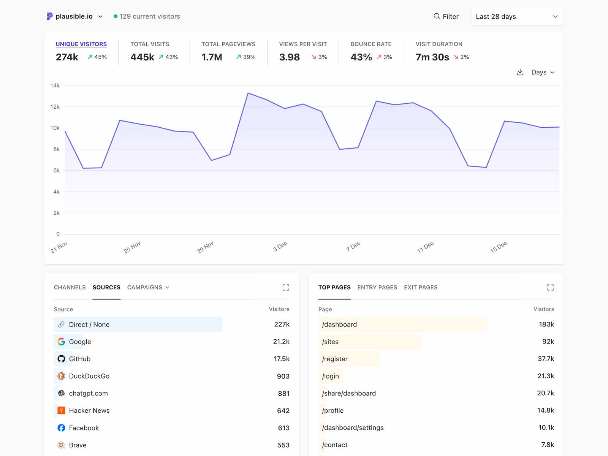
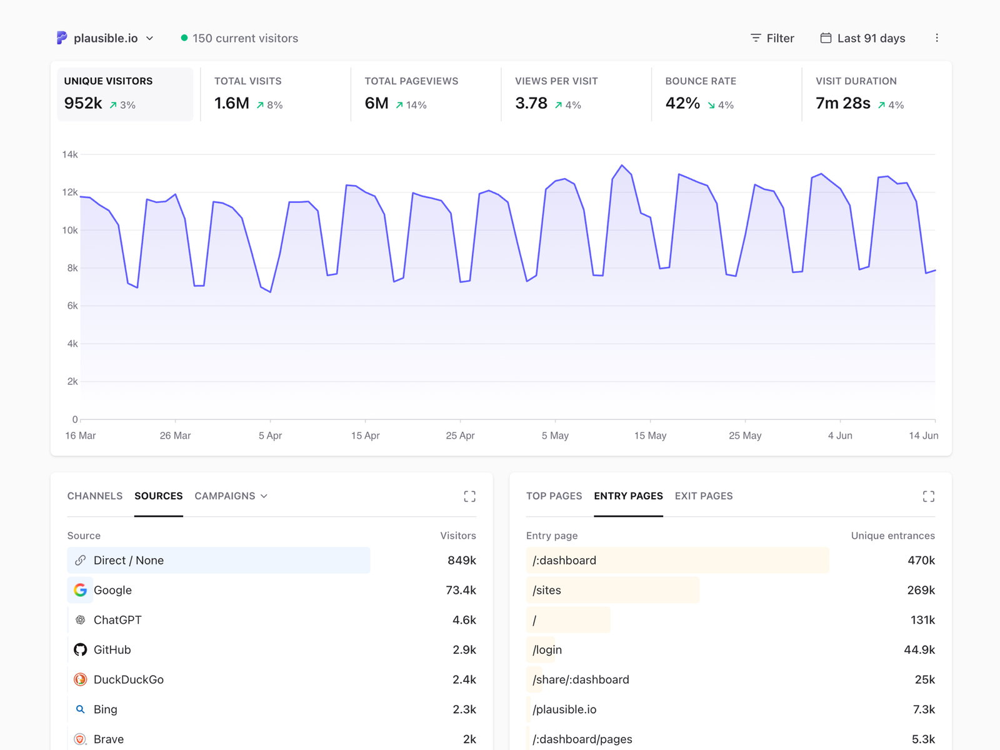

# Plausible Analytics pour YunoHost

Plausible Analytics CE est une analytique web légère, open source et respectueuse de la vie privée (pas de cookies, pas de collecte de données personnelles). Ce paquet l'exécute en natif (Elixir/OTP), sans Docker.

**Version livrée :** voir manifest.toml

## Caractéristiques

- Serveur Elixir/OTP natif, sans Docker
- Tableau de bord protégé par le portail YunoHost (authentification automatique des admins)
- Script de suivi de 1 Ko (public)
- Compatible Google Analytics importer, événements personnalisés

## Liens

- Projet amont : <https://github.com/plausible/analytics>
- Paquet YunoHost : <https://github.com/quartztester/plausible_ynh>

## Screenshots

